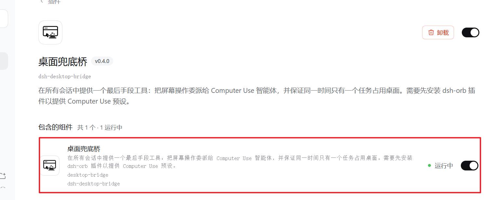
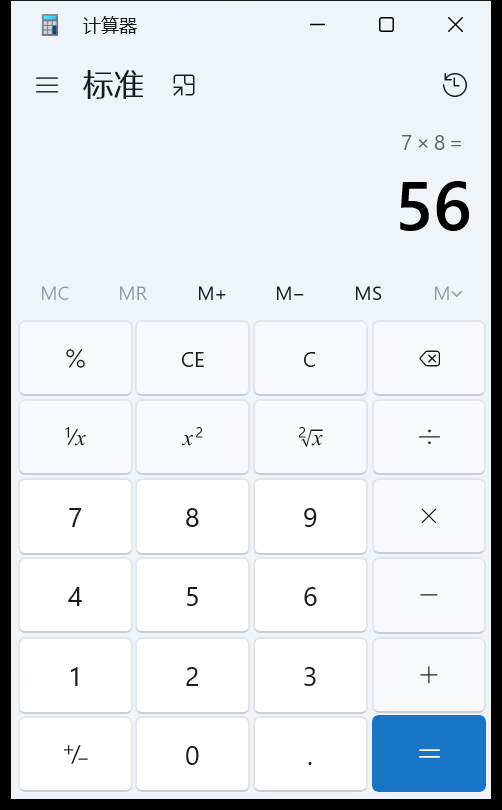

<div align="center">


# Desktop Fallback Bridge

**Give DSH the same Computer Use you get from Codex.**

See the screen · Click · Type · Across apps — from one conversation entry point

**English** | [中文](README.zh-CN.md)


</div>

---

## In one sentence

DSH writes code and runs commands, but it **cannot see what is on your screen**, and it cannot click a single button.

[dsh-orb](https://github.com/mini-yifan/dsh-orb-cordis) provides the actual executor: screen capture, mouse, keyboard, 13 GUI tools.

**This plugin is the layer in between** — one entry point that lets any session hand off the part that needs hands, with the guarantee that exactly **one controller drives the desktop at a time**.

```text
your session ──computer_task──▶ desktop worker ──▶ screenshot / click / type
     │                                  │
     └──── result + verification ◀──────┘
```

---

## Aligned with Codex's Computer Use

| Capability | Codex | dsh-orb + this plugin |
| --- | --- | --- |
| See the screen (target-window capture) | ✅ | ✅ every step starts from the latest frame |
| Click / double / right / drag / scroll | ✅ | ✅ |
| Typing, chords, press-and-hold | ✅ | ✅ |
| Identify foreground app, list apps, launch apps | ✅ | ✅ |
| Workflows spanning several apps | ✅ | ✅ (one scoped stage at a time) |
| Explicit `@Computer` invocation | ✅ | ✅ `@computer` / `@desktop` |
| Structured integrations first (plugin / MCP) | ✅ | ✅ built into the tool criteria |
| One executor on the desktop | platform-level | ✅ task lease + cross-process claim |
| Stops when you stop | ✅ | ✅ stopping the turn interrupts the worker |
| Per-task budget cap | ✅ | ✅ time-and-queue limits, configurable |
| Independent cursor, background operation | macOS only | ❌ Windows is foreground-only (see Boundaries) |
| Per-action human confirmation | ✅ | ⚠️ partial: budget and stop, no per-click prompt yet |

> In short: **the execution surface is on par with Codex; the scheduling and safety model is rebuilt for how DSH actually runs.**
> The two gaps are listed under Boundaries rather than hidden.

---

## Why a bridge layer is needed

dsh-orb already built the hands. What was missing is the **session layer**:

- Who owns the desktop right now? What happens when another session submits?
- The user hits stop halfway through — is the desktop agent still clicking?
- Two DSH processes are open. Which one wins?
- The dependency is missing — how does the user find out before it matters?

This plugin answers those four: **task-level lease, FIFO queue, cross-process claim, cancellation that follows your stop, and a startup self-check.**

---

## Install

```sh
dsh plugin add dsh-orb              # 1. the executor (required)
dsh plugin add dsh-desktop-bridge  # 2. the bridge (this repo)
```

Both cards show up in the plugin page, with the bridge reporting **running**:

<p align="center">
  
</p>

Then just ask:

> Work out 7×8 in the calculator for me

When you want it to **act without deliberating**, tag it:

> **@computer** dismiss that dialog

---

## A real run

This is an actual run: the task was handed to a desktop worker session, which pressed `7 × 8 =` key by key. **The result was not computed by the model — it was read back from the calculator UI.**

<p align="center">
  
</p>

> Only the target window is shown: a full-screen capture would carry personal content and does not belong in a public repo.

---

## When it actually gets used

The criterion is borrowed from Codex: **when a task depends on a graphical interface that cannot be verified from files or command output alone**, hand it to the GUI.

| Need | Route |
| --- | --- |
| Code changes, file reads, batch renames | file / shell |
| A plugin, MCP server, API or skill exists | structured interface |
| Web content | fetch / browser automation |
| A setting only reachable by clicking | **this plugin** |
| A bug that only reproduces in a GUI | **this plugin** |
| A workflow spanning several apps | **this plugin** |
| Looking at the screen / "what am I doing" | screenshot + image read, not this |

**On a full-access Windows machine it gets used less than you would expect** — `pwsh` can call Win32, capture the screen, and drive UI Automation. That is by design: it takes over your desktop only when something genuinely needs a hand.

---

## Boundaries

> **This repository contains no Computer Use implementation.** Capture, clicking and typing all come from dsh-orb. This package only bridges, queues, and enforces limits.
> **Install dsh-orb first**, otherwise `computer_task` refuses and tells you why.

- **Not for observation.** "What am I doing right now" is answered faster and more accurately by a shell screenshot plus an image read, without occupying the desktop.
- **No preemption.** A busy desktop means queueing or timing out, never interrupting a running task.
- **Not cross-machine.** It drives the host desktop, not the device your browser runs on.
- **Not everything is automatable.** Terminal apps, DSH itself, and admin-authorised system dialogs are out of scope.
- **Windows is foreground-only.** It really takes over pointer and keyboard; the independent cursor and background operation Codex has on macOS are not available here.

---

## How ownership works

```text
submit → queue → acquire lease → desktop worker → release → next
```

- **Task-level exclusivity**, not per-click locking. Otherwise A opens a form, B switches windows, and A types into the wrong one.
- **FIFO by default**; the model cannot jump the queue.
- **Cross-process**: an OS-level exclusive handle (a Windows named pipe) claims control; a second process refuses to act instead of fighting for the mouse.
- **Mutual exclusion with the floating ball**: whichever side holds the desktop, the other yields.
- **Stops with you**: stopping the conversation interrupts the desktop worker too.

---

## Configuration

`config` in `cordis.patch.yml`:

| Field | Default | Meaning |
| --- | --- | --- |
| `mode` | `auto` | `auto` applies the criteria; `explicit_only` requires the marker; `off` disables |
| `workerPreset` | `computer-use` | Preset for the worker session, supplied by dsh-orb |
| `maxWaitSeconds` | `300` | Longest queue wait while the desktop is busy |
| `maxRunSeconds` | `600` | Longest time one task may hold the desktop |
| `maxTasksPerSession` | `1` | Concurrent in-flight tasks per session |
| `workerProvider` / `workerModel` | inherited | Worker model, **must accept image input** |

---

## Compatibility

| Item | Note |
| --- | --- |
| DSH | 0.2.x (verified on the desktop app) |
| Platform | Windows first; other platforms unverified |
| Requires | **dsh-orb ≥ 0.2.0** (supplies the `computer-use` preset) |
| Coupling | Only the preset id and the `screen-owner` record; **no dsh-orb code is imported**, so an upgrade cannot break loading |

If the preset is renamed or missing, the plugin says so in a startup self-check and keeps telling the model *why* and *how to fix it* — instead of failing the first time someone asks for the interface.

---

## Known issues

- **The worker can click an occluded window.** In the first real run the calculator sat behind another window and a few clicks landed in an editor, opening a stray tab (which it then closed). Bring the target app to the front, or say so in the task.
- **No native status panel.** State is available through `computer_desktop_status`.
- **No "stop the current task and hand over immediately"** — only queue cancellation, budget expiry, and stop-following.

---

## Development

```sh
node --test --test-concurrency=1 "test/*.test.mjs"
```

34 tests: FIFO / timeout / cancellation, cross-process control, floating-ball collision (judged by the dsh-orb build the host actually loads), explicit-marker parsing, stop-following, and degraded mode without the dependency.

Design rationale and the full verification record: [docs/design-notes.md](docs/design-notes.md).

---

## License

MIT.
